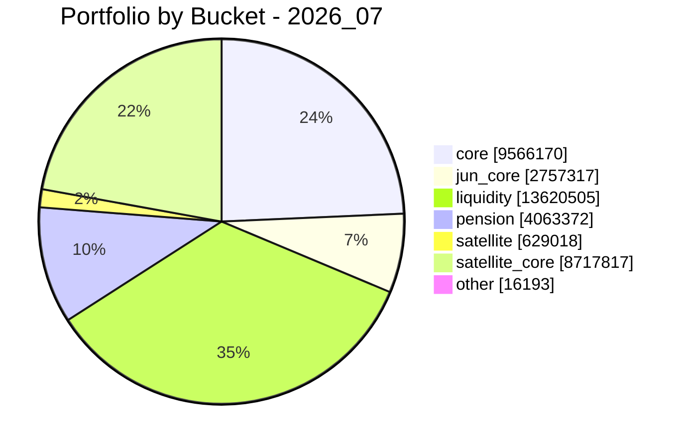
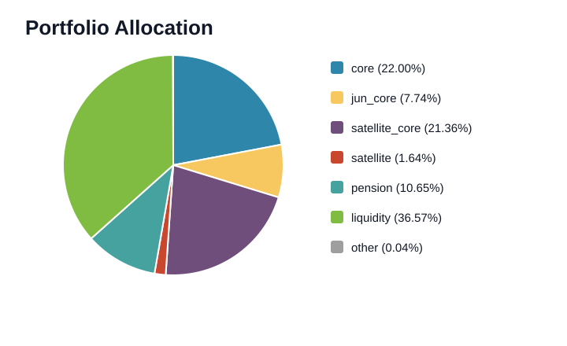

# Monthly Limit Order Review System

Codex が Money Forward キャプチャを直接読み取り・正規化した資産スナップショット YAML を入力にして、ChatGPT 向けの月次レビュー用プロンプト、株式・投資信託・年金のオンデマンド・アセスメント依頼プロンプト、Codex 向けの修正プロンプトを生成する Python CLI です。

本ツールは自動売買ツールではありません。Codex がキャプチャ読取と YAML 正規化、Python が数値計算と履歴保存、ChatGPT が構造化済みデータに対する月次レビューと改善提案を担当し、最終判断と発注はユーザが手動で行います。ChatGPT に Money Forward キャプチャを読ませ、その結果を Codex がドキュメント化する運用は行いません。

## Current Strategy Source of Truth

現在有効な長期方針は [strategy/current.yaml](/Users/tappeiyoshida/projects/stock/strategy/current.yaml) が指す不変の戦略版です。期間限定の承認済み計画は同ファイルの `active_plan_paths` から参照します。

現行の主目的は「今の生活を楽しみつつ無理のない範囲で運用し、65歳時点の投資利益を最大化する」です。持続可能な拠出額を全候補で共通に固定し、資産効率だけを見たオール・カントリー型商品のみの基準案と、趣味として楽しめる正のサテライト配分を比較します。サテライト比率と具体的銘柄は独立ChatGPTがレビューするパラメータで、Codexは先に値を決めません。

収入、支出、ボーナス、生活防衛資金、ローンなど変わり得る家計値は [financial/current.yaml](/Users/tappeiyoshida/projects/stock/financial/current.yaml)、口座区分、売却可否、保有意図は [holdings/current.yaml](/Users/tappeiyoshida/projects/stock/holdings/current.yaml) が指す版管理YAMLを正とします。これらの値をMarkdown、プロンプト、Pythonコードへ重複して固定しません。

月次CLIはこの戦略と計画をCodex側の計算・履歴整合確認に使い、旧 `config/portfolio_policy.yaml` のバケット目標値を現在方針として使用しません。一方、ChatGPT向け独立レビューでは、現行戦略全体、active plan、Python候補値を `review_packet.yaml` へ入れません。ユーザが明示承認したレビュー制約だけは、その承認記録を出典にallowlistへ加えます。旧目標値は過去計算と単体テストの再現用fallbackとしてのみ残し、生成済みの過去レビューは書き換えません。

## Human Approval and Task-Scope Gate

AIの役割はブランド名ではなく、ユーザが依頼したタスクのスコープで分けます。

### Normalization / preparation task

Money Forwardキャプチャの正規化だけを依頼された場合、AIはデータ確定、欠損検出、計算、レビュー材料の生成までで停止します。正規化タスクから売買提案へ暗黙に拡張しません。

### Strategy / portfolio review task

ユーザが明示的に戦略検証、ポートフォリオ診断、購入・売却・リバランス案を求めた場合、AIは `strategy/current.yaml`、対象期間の計画、基準日時点のデータ、最新の一次情報に基づいて提案できます。

ただし、次はすべてのタスクで禁止します。

- AIによる証券注文、送金、自動発注
- 提案を約定・実績として記録すること
- ユーザ未承認の戦略変更
- 値下がりだけを理由にした機械的売却
- 未確認の税制、価格、商品仕様を前提にした確定判断

最終的な採否と発注は常にユーザが行います。

## Human Quick Start: Normalization-only Codex Session Prompt

Money Forwardの正規化だけを始めるときは、Codexの新規セッション冒頭に以下をそのまま貼り付けてください。

```md
あなたはこの `stock` レポジトリのAIアセット保守・月次レビュー準備担当です。

今回のタスク種別は、以下のうちどれかを最初に判定して宣言してください。

1. Money Forwardキャプチャの正規化
2. ChatGPT向け月次レビュー依頼プロンプトの作成
3. ユーザが貼り付けたChatGPT出力の反映
4. AIアセット・プロンプト・運用ルールの改善

今回、ユーザがChatGPTの月次レビュー出力を明示的に貼り付けていない場合、Codexは投資判断をしてはいけません。

## Codexの責務

Codexが行ってよいこと:

- Money ForwardキャプチャをOCR・正規化する
- `data/normalized/snapshot_YYYY_MM.yaml` を作成または更新する
- 欠損、不明点、OCR不確実性、前月差分、分類ミス候補を整理する
- CLIで検証・計算・ChatGPT向け月次レビュー依頼プロンプトを生成する
- 生成したプロンプトをユーザに提示する
- ChatGPTに確認してほしい論点を整理する

## 禁止事項

Codexは以下をしてはいけません。

- 買い、売り、保有、利確、損切り、積立停止、リバランスを確定する
- 購入額、指値、優先順位をCodex自身の結論として提示する
- ChatGPTを介さずに投資判断を生成する
- ChatGPT出力がない状態でREADME、月次サマリー、購入計画、指値設定を更新する
- 「おすすめ」「結論」「実行すべき」という形で投資助言を完結する
- 正規化タスクから投資判断タスクへ勝手に進む

## README履歴ルール

レビュー出力をREADMEへ反映する場合でも、ルートREADMEには最新月の `Monthly Review` だけを残してください。新規生成物は `reports/generated/`、2026-07以前の旧履歴は `data/history/` と `prompts/generated/` で扱います。

## 必ず最初に読むもの

作業前に以下を確認してください。

- `README.md`
- `SPEC.md`
- `prompts/templates/moneyforward_monthly_session_start_prompt.md`
- `prompts/moneyforward_normalization_prompt.md`
- 直近の `data/normalized/snapshot_YYYY_MM.yaml`
- 必要に応じて `config/` 配下のルール

## 実施手順

1. `git status` を確認する
2. 既存AIアセットの責務境界を確認する
3. Money Forwardキャプチャを一次情報として正規化する
4. 既存スナップショットと照合する
5. 不明点・警告・検証結果を残す
6. CLIでChatGPT向け月次レビュー依頼プロンプトを生成する
7. 生成物と注意点をユーザに報告する
8. そこで停止する

## ハンドオフ条件

以下のいずれかに到達したら、Codexは停止してください。

- 正規化済みスナップショットができた
- ChatGPT向け月次レビュー依頼プロンプトができた
- 投資判断が必要な論点を整理し終えた

停止時に出力してよいもの:

- 作成・更新したファイル
- 正規化結果の要約
- 不明点・欠損・注意点
- ChatGPTに貼り付けるプロンプト
- ChatGPTに確認してほしい論点

この先の投資判断はCodexが行わず、ユーザがChatGPTに貼り付けるまで待ってください。
```

## Monthly Review: 2026_07

> このセクションは `strategy/versions/2026-07-25.yaml` 承認前の旧ルールで生成された履歴表示です。現在の判断には、上記の Current Strategy Source of Truth と active plan を使用してください。

- snapshot_date: 2026-06-28
- total_assets_jpy: 39,370,393円
- review_source: [data/history/reviews/chatgpt_review_2026_07.txt](/Users/tappeiyoshida/projects/stock/data/history/reviews/chatgpt_review_2026_07.txt)

### Monthly Review Summary

- 6月は投資信託カテゴリが大きく増え、前回方針どおり core 補強が進んだ可能性が高い。ただし、取引明細未確認のため「実行済み購入」とは断定しない
- 7月は core不足 24.30% vs 目標45.00%、liquidity 34.60% vs 目標10.00% の是正を最優先にする
- ChatGPT月次レビューでは、7月の core スポット買い提案は 900,000円
- 固定core積立100,000円と合わせ、7月のcore投入合計は 1,000,000円
- SOX投信は買いゾーン内でも追加購入見送り。satellite_core と半導体 direct exposure が既に高いため
- 長期シナリオは URA / CIBR / MSFT は継続保有でよく、PLTR は事業モメンタムは強いが要監視
- 今月の優先順位は `オルカン > S&P500 > MSFT深め > URA深い押し目 > PLTRさらに深い押し目 > CIBR/SOX見送り`

### Purchase Plan

2026年NISA成長投資枠は枯渇済みのため、固定core積立はNISAつみたて投資枠100,000円/月として扱う。ChatGPT月次レビューでは、NISAより税効率は落ちても、core不足と現金過多の是正を優先し、特定口座で 900,000円の core スポット買いを行う提案になった。

| item | amount_jpy | account | note |
| --- | ---: | --- | --- |
| NISA固定core積立 | 100,000 | NISAつみたて投資枠 | eMAXIS Slim 全世界株式50,000円 + eMAXIS Slim 米国株式50,000円 |
| coreスポット買い | 900,000 | 特定口座 | aggressive band。オルカン65% / S&P500 35% |
| 7月のcore投入合計 | 1,000,000 |  | 固定core積立100,000円 + coreスポット買い900,000円 |
| iDeCoオルカン積立 | 55,000 | iDeCo | pensionとして別枠で把握 |
| BTC/ETH週次積立 | 4,000 / week | 暗号資産 | BTC 2,000円/週 + ETH 2,000円/週。維持 |

| fund | amount_jpy |
| --- | ---: |
| eMAXIS Slim 全世界株式（オール・カントリー） | 585,000 |
| eMAXIS Slim 米国株式（S&P500） | 315,000 |
| **合計** | **900,000** |

| date | fund | amount_jpy |
| --- | --- | ---: |
| 2026-07-01 | eMAXIS Slim 全世界株式（オール・カントリー） | 200,000 |
| 2026-07-01 | eMAXIS Slim 米国株式（S&P500） | 100,000 |
| 2026-07-08 | eMAXIS Slim 全世界株式（オール・カントリー） | 135,000 |
| 2026-07-08 | eMAXIS Slim 米国株式（S&P500） | 75,000 |
| 2026-07-15 | eMAXIS Slim 全世界株式（オール・カントリー） | 125,000 |
| 2026-07-15 | eMAXIS Slim 米国株式（S&P500） | 70,000 |
| 2026-07-22 | eMAXIS Slim 全世界株式（オール・カントリー） | 125,000 |
| 2026-07-22 | eMAXIS Slim 米国株式（S&P500） | 70,000 |
| **合計** |  | **900,000** |

### Limit Buy Settings

7月は core スポット買いを最優先にし、テーマ銘柄の指値は約定しても core 補強を圧迫しない小口に限定する。satellite_core が over target のため、CIBR と SOX投信は見送り、URA / PLTR / MSFT は深い押し目だけを対象にする。

| target | limit setting | 20d avg | avg gap | shares | status | note |
| --- | ---: | ---: | ---: | ---: | --- | --- |
| URA | 40.65 USD | 47.8267 USD | -15.01% | 2 | set | satellite_core over target のため浅い段は見送り、-15%のみ採用 |
| PLTR | 104.15 USD | 133.5195 USD | -22.00% | 2 | set | 高ボラティリティ銘柄。-22%のさらに深い押し目のみ |
| MSFT | 365.67 USD | 406.2960 USD | -10.00% | 1 | set | jun_core不足側だが、7月は broad market core 優先のため1株に圧縮 |
| CIBR | - | 84.9617 USD | - | - | skip | satellite_core over target。eligible deep candidate なし |
| SOX投信 / SMH | - | - | - | - | skip | satellite_core over target、半導体 direct exposure 17.80% |

### Portfolio Summary

| bucket | market_value_jpy | actual_pct | target_pct | delta_pct |
| --- | ---: | ---: | ---: | ---: |
| core | 9,566,170 | 24.30% | 45.00% | -20.70pt |
| jun_core | 2,757,317 | 7.00% | 20.00% | -13.00pt |
| liquidity | 13,620,505 | 34.60% | 10.00% | +24.60pt |
| pension | 4,063,372 | 10.32% | - | - |
| satellite | 629,018 | 1.60% | 10.00% | -8.40pt |
| satellite_core | 8,717,817 | 22.14% | 15.00% | +7.14pt |
| other | 16,193 | 0.04% | - | - |

- core は目標45.00%に対して24.30%で不足
- liquidity は34.60%で、目標10.00%を大きく上回る過大待機資金
- satellite_core は22.14%で目標15.00%を超過
- 半導体 direct exposure は17.80%
- direct + indirect AI infrastructure watch metric は19.18%
- iDeCoのオルカン55,000円/月は pension として扱い、tradable core とは分けて評価する
- BTC/ETHの週4,000円積立は、ChatGPT月次レビューでは維持でよいとされた

### Validation Notes

- スクリーンショット内に取得日が見えないため、セッション日付 2026-06-28 を snapshot_date とした
- 株式（現物）の明細合計は 5,193,712円で、カテゴリ合計 5,193,713円との差は -1円。Money Forwardの表示丸め差として許容
- 6月の実際の取引明細は未確認。投資信託カテゴリ増加は core 購入実行の可能性として扱い、実行済み購入とは断定しない
- EMAXIS_SLIM_SP500_1 と EMAXIS_SLIM_ALL_COUNTRY は large_month_over_month_change warning 対象。OCR・購入・評価額変動・口座分類差分の確認対象として扱う
- PLTR は9株から11株、MSFT は7株から9株、URA は68株から70株に増加。取引明細未確認のため、6月の指値または裁量買いの可能性として扱う

### Mermaid Pie Chart



## Superseded Monthly Purchase Policy: 2026_05 to 2026_12

> 以下は `strategy/versions/2026-07-25.yaml` の承認前に使っていた旧方針です。履歴再現のため残しますが、現在の購入判断には使用しません。現行の期間限定計画は `strategy/current.yaml` の `active_plan_paths` を参照してください。

2026年5月〜12月は、2026年NISA成長投資枠枯渇により、core固定積立はNISAつみたて投資枠100,000円/月のみとして扱う。

| item | amount_jpy | account | note |
| --- | ---: | --- | --- |
| eMAXIS Slim 全世界株式（オール・カントリー） | 50,000 | NISAつみたて投資枠 | 固定core積立 |
| eMAXIS Slim 米国株式（S&P500） | 50,000 | NISAつみたて投資枠 | 固定core積立 |
| **固定core積立合計** | **100,000** |  | NISA成長投資枠750,000円/月は前提にしない |

| item | amount | account | note |
| --- | ---: | --- | --- |
| eMAXIS Slim 全世界株式（オール・カントリー） | 55,000円/月 | iDeCo | pensionとして別枠で把握 |
| BTC | 2,000円/週 | 暗号資産 | 既存の週次積立 |
| ETH | 2,000円/週 | 暗号資産 | 既存の週次積立 |

core不足と現金過多が続く限り、NISA成長投資枠の不足分は特定口座でのcoreスポット買いを厚くして補う。税効率はNISAより落ちるが、2026年5月〜12月の主問題は税効率ではなく、core不足と現金過多による基本配分の歪みである。

| mode | core spot buy range | condition |
| --- | ---: | --- |
| Normal | 300,000〜600,000円 | core不足はあるが現金過多が軽度、または相場が高値圏 |
| Aggressive | 700,000〜1,000,000円 | core不足が大きく、liquidity が target を大きく上回る |
| Rebalance | 1,000,000〜1,500,000円 | core_delta_pct が -25pt 程度以下、cash_excess_pct が +25pt 程度以上 |

Rebalance mode では、固定core積立100,000円 + 特定口座coreスポット買い1,280,000円 = 月次core投入1,380,000円を目安にする。iDeCo55,000円/月とBTC/ETH週次積立もキャッシュアウトとして別枠で考慮し、総投資額は月145万円程度を目安にする。ただし単月のcoreスポット買いは原則1,500,000円を上限とし、住宅ローン・生活防衛資金・大口支出不明リスクを考慮して現金を一気に削りすぎない。

coreスポット買いの配分は既存core商品に限定し、基本は eMAXIS Slim 全世界株式（オール・カントリー）60% / eMAXIS Slim 米国株式（S&P500）40% とする。米国株・半導体・AIインフラ感応度が高い月は、オルカン65% / S&P500 35% などオルカンを厚めにする。

<!-- portfolio-piechart:start -->
## Latest Portfolio Snapshot

- snapshot_date: 2026-06-28
- total_assets_jpy: 39370393



| bucket | market_value_jpy | pct |
| --- | ---: | ---: |
| core | 9566170 | 24.30% |
| jun_core | 2757317 | 7.00% |
| satellite_core | 8717817 | 22.14% |
| satellite | 629018 | 1.60% |
| pension | 4063372 | 10.32% |
| liquidity | 13620505 | 34.60% |
| other | 16193 | 0.04% |
<!-- portfolio-piechart:end -->

## 目的

- 月初の指値設定を一貫したルールでレビューする
- ポートフォリオの偏りとリスク警告を毎月構造化して残す
- ChatGPT の改善提案を Codex 向けの編集粒度に落とし込む
- Python 候補値と ChatGPT 最終提案の差分を保存する
- ルート README には月次レビュー履歴を蓄積せず、最新月の `Monthly Review` だけを見やすい順序で残す
- 2026-07以前の生成履歴は `data/history/` と `prompts/generated/` に凍結し、新規生成物は `reports/generated/` に保存する
- 月次レビューを待たず、保有銘柄の直近価格変動と信頼性の高いニュースを突き合わせる ChatGPT 向けアセスメント依頼プロンプトを生成する

## オンデマンド・ヘルスチェック

オンデマンド機能は、最新の保存済みスナップショットを保有銘柄リストとして使い、個別株・ETF全件の投資ストーリー、直近価格、一次情報、ニュースを照合します。保有額・数量・取得単価・含み損益・配分は入力せず、月次の配分判断とは分離します。

実行頻度は任意です。余力があれば毎日実行できますが、連続実行を前提にしません。前回の完了済み `health_check_response.yaml` から空白期間がある場合、次回の調査期間を自動的に広げます。初回は30日、通常は最低14日、空白回収は最大90日です。月次レビューも個別株・ETF全件を評価するため、オンデマンド実行を飛ばしても運用全体は停止しません。

オンデマンド作成を始めるときは `prompts/templates/on_demand_market_assessment_session_start_prompt.md` を Codex に渡します。保有銘柄の変更がなければ、Money Forward の最新画面を撮り直す必要はありません。

1. 最新の `data/normalized/snapshot_*.yaml` から株式・投資信託・年金の銘柄名だけを抽出する
2. `health-check-run` で各銘柄・プロキシの最新日足終値と1日、5日、1か月、3か月の変化を取得する
3. 取得時点、プロキシ使用、欠損を明示した ChatGPT向けプロンプトを生成する
4. ChatGPT が企業IR、取引所、政府・中央銀行等の一次情報と信頼性の高い市場報道をWeb調査する
5. 個別株・ETF全件について、評価実施、ストーリー健全性、保持・買い増し・縮小・売却判断、根拠、次回トリガーを残す
6. ユーザ向け日本語Markdownと、Codex向け `health_check_response.yaml` を分離して返す

```bash
.venv/bin/python -m monthly_limit_order_review.cli health-check-run \
  --news-lookback-days 14
```

ChatGPTから受け取ったCodex向けYAMLは、全銘柄の評価が揃っていることを検証して保存します。検証済みファイルだけが、次回の空白期間計算で「完了済み」として使われます。

```bash
.venv/bin/python -m monthly_limit_order_review.cli ingest-health-check \
  --response-yaml /path/to/health_check_response.yaml
```

`--snapshot` を省略すると、日付が最も新しい正規化済みスナップショットを銘柄リストとして使います。銘柄リストが古くても価格取得は止めず、その可能性を注記します。`yfinance` の価格は最新取得可能な日足終値であり、リアルタイム気配値ではありません。

オンデマンド処理は次を行いません。

- `README.md` の `Monthly Review` 更新
- 月次計算・月次プロンプト履歴の上書き
- coreスポット買いの Google Calendar イベント作成
- 保有額、損益、配分、現金余力のポートフォリオ診断
- ChatGPT出力なしでの売買判断の確定

## 毎月のワークフロー

1. ユーザが Codex セッションに Money Forward のスクリーンショットを添付する
2. 必要に応じて、Money Forward の画面からコピーしたテキストも Codex に貼る
3. Codex が [prompts/moneyforward_normalization_prompt.md](/Users/tappeiyoshida/projects/stock/prompts/moneyforward_normalization_prompt.md) のルールに従い、スクリーンショットを一次情報として OCR・正規化する
4. Codex が `data/normalized/snapshot_YYYY_MM.yaml` を作成または更新する
5. 例として [data/normalized/snapshot_2026_03.yaml](/Users/tappeiyoshida/projects/stock/data/normalized/snapshot_2026_03.yaml) の形式を使う
6. Codex / CLI が合計、カテゴリ、通貨、分類、前月差分、重複、OCR由来の不確実性を検証する
7. CLI で市場データ取得、比率計算、ルール計算、警告抽出を実行する
8. CLI がallowlistで `review_packet.yaml` を作り、その同じパケットから `review_request.md` を生成する
9. 全売買可能明細がNISA・特定口座・一般口座のいずれかに分類済みであることを生成前ゲートで確認する。不足時はレビュー依頼を生成せず、口座確認後に再実行する
10. 利用者が `review_request.md` 冒頭の実行前チェックを確認し、資産運用Project外の新規Temporary Chat等で、レビュー・パケットだけをChatGPTへ渡す
11. ChatGPT が数値事実とユーザー条件に加え、個別株・ETF全件を一次情報で調査し、ストーリー健全性と判断痕跡を返す
12. ChatGPT はユーザ向け日本語MarkdownとCodex向け `review_response.yaml` を分離し、CodexはYAMLだけを機械取り込みする
13. Codex が回答を履歴、税務・口座制約、実行可能額と照合してから、CLIでレビュー取り込み、差分保存、Codex向け修正プロンプト生成、coreスポット買いのGoogle Calendarイベントドラフト生成を行う
14. Codex は生成されたイベントドラフトを使い、ChatGPT が決めた coreスポット買い実行スケジュールを手動発注リマインダーとして Google Calendar に作成する
15. ユーザがChatGPT出力またはCodex向け修正プロンプトを明示的に貼り付けた場合のみ、Codex がREADME の最新月セクションに月次サマリー、購入計画、今月の指値買い設定、ポートフォリオサマリーを反映する
16. README 更新時は既存の `## Monthly Review: YYYY_MM` を最新月の内容に置換し、過去月の `Monthly Review` セクションをルートREADMEに残さない

将来の月次レビュー開始時は [prompts/templates/moneyforward_monthly_session_start_prompt.md](/Users/tappeiyoshida/projects/stock/prompts/templates/moneyforward_monthly_session_start_prompt.md) を Codex に貼り、スクリーンショット添付から始める。

## 独立レビューのブラインド実行

プロンプト本文だけではChatGPT側の会話履歴やProject参照を消去できません。毎回、`review_request.md` 冒頭のチェックに従って次を実施します。

- ChatGPTの資産運用Project内では実行しない
- Project外の新規Temporary Chatなど、過去会話を参照しない環境で実行する
- 前月のレビュースレッドを再利用しない
- `review_request.md` 以外のファイルを添付しない
- 独立レビューへ影響するカスタム指示を無効化するか、影響を確認する

`review_packet.yaml` は今回選択した事実の監査用です。ChatGPTへ追加添付するファイルではありません。パケット外情報を使った最新税制・商品仕様・口座制約の確認は、ChatGPT回答をCodexへ戻した後に行います。

## 口座区分と税引後最適化

同一商品が複数明細に分かれていても、連番サフィックスや商品名の一致だけで重複・一本化対象と判定しません。NISA、特定口座、一般口座、iDeCoなどの口座区分は売却判断の必須属性として扱い、正規化時に制度・枠まで可能な限り記録します。

月次レビューでは、経済的エクスポージャーの合算と、売却する口座・取得ロットの選択を分離します。売却・移管・一本化を提案する場合は、口座区分、取得価額、含み損益、概算税額、税引後手取額、NISA非課税保有と枠への影響を比較します。売買可能な全明細の口座区分がNISA・特定口座・一般口座のいずれかに確定するまでは、削減エクスポージャーの部分評価を含めてChatGPT向けレビュー依頼とレビュー結果を一切生成しません。

レビュー結果は、現在保有する全売買可能明細について、何を保有・一部売却・全部売却するか、いつ、どの口座で、どの方法と数量または金額で行うかを一件ずつ示します。現在未保有の資産についても具体的な購入案、または新規購入しない結論と理由を必須とします。

2026-08-02に確認した国税庁・金融庁の一次情報では、NISAの譲渡益は制度要件を満たす範囲で非課税、NISA内の譲渡損は課税口座との損益通算・繰越控除不可です。2024年以降のNISAは売却商品の簿価分の非課税保有限度額を翌年以降に再利用できます。旧NISAを含む制度区分と取得年は実行前に再確認します。

## 表示名と機械ID

ユーザ向けの日本語Markdownでは、銘柄コード、ティッカー、連番付き内部IDを表示せず、正式な会社名・商品名を使います。同一商品の複数明細は口座区分を付け、口座不明の場合は「商品名（口座区分未確認の2明細）」または評価額などユーザが確認できる属性で区別します。

`9444`、`NISSEI_SOX_1` のような値は、Codex向けYAMLの `symbol` フィールドに限って保持します。Codexは人間向け表示名から機械IDを推測せず、YAMLの対応を使います。

## 役割分担

- Python: YAMLロード、市場参照取得、配分・集中度計算、警告、候補価格、allowlist型レビュー・パケット、差分、生成物保存、リポジトリ監査
- Codex: 履歴・保有データ・ユーザー条件・過去判断を管理し、判断に必要な事実だけをパケットへ選び、独立ChatGPT向けプロンプトを生成し、回答を税務・口座・実行制約と照合する。新しい投資判断そのものは行わない
- ChatGPT: 過去助言やCodex結論を知らない独立レビュアーとして、パケットだけから確定判断・条件付き判断・算定不能を分離し、導出可能な具体的実行案と入力契約の改善案を返す
- ユーザ: 戦略変更、購入・売却・リバランスの採否を決め、証券会社で手動実行する

AIのブランド名を承認境界にせず、`strategy/current.yaml`、active plan、基準日時点のデータ、ユーザが明示したタスク範囲で役割を決めます。

月次レビュー外で新しい資産配分、比率、閾値、銘柄選択、売買判断が必要になった場合、Codexは自分で調査して結論を出しません。確認済み事実、ユーザー制約、不明情報、判断課題だけを `on-demand-decision-prompt` 用パケットへまとめ、資産運用Project外の新規Temporary ChatでChatGPTのセカンドオピニオンを取得するようユーザへ依頼します。Codexの候補値や既存設定はアンカーになるため除外します。

```bash
.venv/bin/python -m monthly_limit_order_review.cli on-demand-decision-prompt \
  --request path/to/decision_request.yaml \
  --output path/to/independent_decision_request.md
```

ユーザが `independent_decision_response.yaml` と人間向け回答を戻した後にだけ、Codexは契約検証、既存方針との照合、ユーザ承認済み変更の実装を行います。

```bash
.venv/bin/python -m monthly_limit_order_review.cli validate-independent-decision \
  --request path/to/decision_request.yaml \
  --response-yaml path/to/independent_decision_response.yaml
```

この検証は、対応する `decision_id`、必須項目、判断状態、ユーザ確認ゲートを確認するだけで、回答を自動承認したり売買を実行したりしません。

## セットアップ

```bash
python3 -m venv .venv
source .venv/bin/activate
python -m pip install -r requirements.txt
python -m pip install -e .
```

## Quick Start (ユーザ向け)

1. リポジトリの参照整合性を検証します

```bash
python -m monthly_limit_order_review.cli repository-audit
```

2. 対象スナップショットで月次処理を実行します

```bash
python -m monthly_limit_order_review.cli monthly-run \
  --snapshot data/normalized/snapshot_2026_07.yaml
```

3. `reports/generated/monthly/2026_07/review_packet.yaml` のselected_sourcesと対象外情報を確認し、`review_request.md` 冒頭の実行前チェックに従って独立レビューを実行します

- 保存先例: `reports/review_inputs/2026_07_chatgpt_review.txt`

4. 回答を取り込み、差分と実装修正依頼を生成します

```bash
python -m monthly_limit_order_review.cli ingest-review \
  --snapshot data/normalized/snapshot_2026_07.yaml \
  --review-yaml reports/review_inputs/review_response.yaml

python -m monthly_limit_order_review.cli generate-codex-patch \
  --snapshot data/normalized/snapshot_2026_07.yaml \
  --review-yaml reports/review_inputs/review_response.yaml
```

5. `reports/generated/monthly/2026_07/`を確認します

- `computation.yaml`
- `review_packet.yaml`
- `review_request.md`
- `review_response.yaml`
- `proposal_diff.yaml`
- `calendar_events.yaml`
- `codex_patch_request.yaml`
- `codex_patch_request.md`

## 入力 YAML の作り方

- Codex が Money Forward スクリーンショットを OCR し、既存スナップショット形式へ正規化します
- キャプチャ読取と正規化は Codex セッション内で完結させ、ChatGPT には正規化後のレビュー用プロンプトだけを渡します
- Money Forward からコピーしたテキストは補助情報として扱います。HTML/web view 由来のコピーは、レイアウト、列、階層、並び順、カテゴリとの対応が崩れる可能性があります
- 金額と項目の対応、口座区分、カテゴリ、並び順はスクリーンショットを優先して確定します
- 画像とテキストが矛盾する場合は、原則として画像を優先し、矛盾を `ocr_notes` または `validation_notes` に残します
- 保存ファイル名は `snapshot_date` に合わせて `data/normalized/snapshot_YYYY_MM.yaml` とします
- 読み取れない値は `null` にします
- 推測した値は `notes`、`ocr_notes`、`validation_notes` のいずれかで推測であることを明示します
- `asset_class` は `liquidity`, `core`, `jun_core`, `satellite_core`, `satellite`, `pension`, `other` のいずれかを付けます
- `currency_base` は原則 `JPY` を入れます
- サンプルは [data/normalized/snapshot_2026_03.yaml](/Users/tappeiyoshida/projects/stock/data/normalized/snapshot_2026_03.yaml) を参照してください

## Evidence Priority

1. Money Forward スクリーンショット / 画像: 資産名、金額、カテゴリ、口座ラベル、視覚的な grouping の一次情報
2. 既存リポジトリデータ / 前月スナップショット: 継続性、資産同一性、既存分類、月次差分の異常検知
3. Money Forward から貼り付けられたテキスト: ラベルや数字の確認用の補助情報。レイアウト、順序、階層、列対応は信用しない
4. 推測: 必要な場合のみ使い、推測であることを明示する。不明値を黙って補完しない

## OCR Normalization Fields

Money Forward スクリーンショットから読み取れる範囲で以下を残す。

- `snapshot_date`
- `currency_base`
- `total_assets_jpy`
- `category_totals_jpy`
- `source_evidence`
- `ocr_notes`
- `validation_notes`
- holdings ごとの `symbol`, `name`, `source_category`, `institution`, `account_type`, `asset_class`, `quantity`, `avg_cost`, `current_price`, `unit_price`, `profit_loss_jpy`, `valuation_jpy`, `market_value_jpy`, `currency`, `notes`

`category_totals_jpy` は、Money Forward 画面上のカテゴリ名を使う場合は holdings の `source_category` と対応させる。リポジトリ分類で合計する場合は `asset_class` と対応させる。

読み取れない項目は `null` にする。同一ファンドや資産は、既存ルールが明示しない限り合算しない。

## Snapshot Validation

月次レビュー用プロンプトを生成する前に、少なくとも以下を確認する。

- `total_assets_jpy` と holdings の合計が大きく矛盾していないか
- `category_totals_jpy` がある場合、カテゴリ合計と該当 holdings 合計が大きく矛盾していないか
- `currency_base` と holdings の `currency` が想定範囲か
- 前月存在した資産が不自然に消えていないか
- 同一資産の月次増減が異常に大きくないか
- OCR や貼り付けテキスト由来の重複がないか
- NISA / 特定 / 年金 / 現金 / 預金の分類が `asset_class` と矛盾していないか
- core / satellite / pension / liquidity の扱いが既存ルールと矛盾していないか

数値整合、OCR、欠損などのデータ品質警告はレビュー・パケットへ含める。戦略目標、active plan、候補注文、推奨予算に由来する警告は独立レビューを誘導するためパケットへ含めず、Codex側の計算・履歴検証に保持する。警告は常にレビュー全体をブロックするものではない。不明情報がある場合、ChatGPTは確定判断・条件付き判断・算定不能を分離し、根拠のない一点推定をせず、不足入力とテンプレート改善案をCodexへ返す。

現金要件は用途別に分ける。生活防衛資金、近い将来の確定支出、明示的な予備費は必要支出等の入力から積み上げ、総資産比率や目標株式比率から逆算しない。投資待機資金は別構成要素とし、独立ChatGPTが根拠とともに提案しユーザが承認した総資産比率だけを使って、「レビュー基準日の総資産 × 承認比率」で目標額を算定する。比率が未承認なら算定不能とし、Codexや月次レビューで先回りして決めない。収入と通常月収支は通常支出の妥当性確認や条件付き推論には使えるが、月間必須支出や支出月数の確定値には代用せず、資産総額から支出を推定しない。目標額を算定できても、買付対象、発動条件、分割投入、最低残高、補充方法が未設定なら、実際の買付は条件付きとする。

投資待機資金は「確保し続けること」を目的とせず、下落局面で投資に使うための手段とする。月次レビューとオンデマンド・ヘルスチェックは、市場下落時に必ず使用案を比較対象に入れる。使用案には対象、金額または算式、時期、根拠を含め、最終結論が使用見送りでも使用案自体は省略しない。`review_response.yaml` と `health_check_response.yaml` の `dip_buy_liquidity_deployment_review` でこの比較を機械検証する。

## 主要コマンド

月次レビュー用プロンプト生成:

```bash
python -m monthly_limit_order_review.cli generate-review-prompt \
  --snapshot data/normalized/snapshot_2026_07.yaml
```

ChatGPT レビュー取り込み:

```bash
python -m monthly_limit_order_review.cli ingest-review \
  --snapshot data/normalized/snapshot_2026_07.yaml \
  --review-yaml reports/review_inputs/review_response.yaml
```

このコマンドは `reports/generated/monthly/YYYY_MM/calendar_events.yaml` も生成する。`events[].google_calendar_request` は証券会社への自動発注ではなく、手動発注リマインダーのドラフトとして扱う。

Codex 向け修正プロンプト生成:

```bash
python -m monthly_limit_order_review.cli generate-codex-patch \
  --snapshot data/normalized/snapshot_2026_07.yaml \
  --review-yaml reports/review_inputs/review_response.yaml
```

月次の計算とプロンプト生成をまとめて実行:

```bash
python -m monthly_limit_order_review.cli monthly-run \
  --snapshot data/normalized/snapshot_2026_07.yaml
```

オンデマンド・ヘルスチェック依頼プロンプト生成:

```bash
python -m monthly_limit_order_review.cli health-check-run \
  --news-lookback-days 14
```

このコマンドは月次アーティファクトやREADMEを更新せず、タイムスタンプ付きのプロンプトと計算履歴だけを保存する。回答後は `ingest-health-check --response-yaml ...` で全銘柄カバレッジを検証し、同じディレクトリへ `health_check_response.yaml` を保存する。

## 生成物と旧履歴

- 新しい月次生成物: `reports/generated/monthly/YYYY_MM/`
- 新しいオンデマンド生成物: `reports/generated/on_demand/YYYY/<timestamp>/`
- 外部レビュー原文: `reports/review_inputs/`
- 2026-07以前の旧生成物: `data/history/`と`prompts/generated/`
- 旧生成物の分類: [reports/legacy-index.yaml](/Users/tappeiyoshida/projects/stock/reports/legacy-index.yaml)

旧履歴は再配置や再生成を行わず、不変のアーカイブとして保持します。

## 差分保存の意味

- 毎月の判断を感覚論にしないため
- ChatGPT がどう候補を上書きしたかを蓄積するため
- 次の Codex 修正要求を具体化するため

## テスト

```bash
.venv/bin/python -m pytest -q
PYTHONPATH=src .venv/bin/python -m monthly_limit_order_review.cli repository-audit
```

## 注意事項

- 最終判断は人間が行います
- 発注は人間が証券会社で手動で行います
- 本ツールは助言補助と構造化補助のための CLI です
- 自動発注、証券会社 API 接続、ブラウザ自動操作は実装していません
