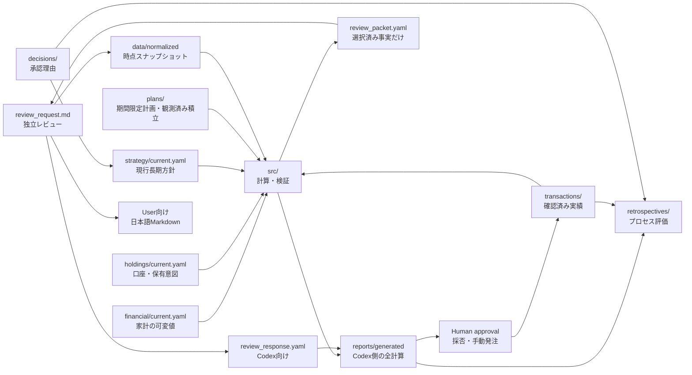

# Repository architecture

## Data flow

## Sources of truth

| Responsibility | Source of truth | Notes |
| --- | --- | --- |
| 家計・ローンの可変値 | `financial/current.yaml`が指す版 | 有効日・確認日を持つ。収入・支出等の現在値 |
| 口座・売却可否・保有意図 | `holdings/current.yaml`が指す版 | スナップショットを改変せず実行時に重ねる |
| 家計値の読み方・不変ルール | `FINANCIAL_ASSUMPTIONS.md` | 数値の正本にしない |
| 外部の未加工証拠 | `data/raw/` | 存在しない過去証拠は再生成しない |
| 正規化済み残高 | `data/normalized/snapshot_YYYY_MM.yaml` | 時点事実、過去は原則不変 |
| 現行長期方針 | `strategy/current.yaml`が指す版 | 現在版は一意 |
| 投資仮説 | `strategy/theses/` | activeとpendingを区別 |
| 期間限定計画 | `plans/` | 承認状態と根拠スナップショットを持つ |
| 定期積立の観測状態 | `plans/recurring/current.yaml`が指す版 | 戦略との一致を意味しない |
| 注文・約定・入出金実績 | `transactions/ledger.yaml` | 確認済みだけを記録 |
| 意思決定理由 | `decisions/` | 過去記録を上書きしない |
| レトロスペクティブ | `retrospectives/` | 当時情報と結果を分離 |
| 計算・検証 | `src/`、`config/` | `config`は計算設定。戦略値の正本にしない |
| 自動生成物 | `reports/generated/` | 手編集・正本化しない |

## Independent review boundary

Codex側の計算は現行戦略、active plan、過去履歴を整合確認に使えるが、ChatGPT向け月次独立レビューへそのまま渡さない。`ReviewPacket` が現在の数値事実、明示済みユーザー条件、確定済み支出・継続設定、不明情報だけをallowlistで選び、現行戦略全体、active plan、過去回答、候補注文、推奨予算を除外する。ユーザが明示承認した集中上限などは、一般戦略値ではなく確認済みユーザ条件として承認記録を出典に渡す。

`review_request.md` は `review_packet.yaml` と同じ構造から生成する。会話履歴やProject参照の分離はプロンプトだけでは保証できないため、資産運用Project外の新規Temporary Chat等、前月スレッド不使用、追加添付なし、カスタム指示確認を実行前チェックで担保する。

個別株・ETFは、投資仮説が登録されている銘柄だけでなく保有一覧から全件を `security_story_review_targets` へ展開する。月次レビューとオンデマンド・ヘルスチェックの双方で、評価実施、ストーリー健全性、保持・買い増し・縮小・売却判断、根拠、次回確認トリガーを記録する。仮説未記録は省略理由にせず、`missing` として暫定ストーリーの再構成対象にする。

人間向け回答とCodex向け入力は分離する。人間向けは日本語Markdown、Codex向けは月次 `review_response.yaml` またはオンデマンド `health_check_response.yaml` とし、CodexはMarkdownから判断値を推測しない。月次YAMLでは、現金要件の導出状態、売買ごとの根拠監査、不足入力とテンプレート改善案を構造化する。入力不足はその場で一点補完せず、ChatGPTからCodexへ `prompt_feedback` として戻し、次回のパケット生成へ反映する。

月次外で新しい投資判断が必要な場合は、Codexから直接判断へ進まず、`on_demand_independent_investment_decision` パケットを生成する。Codexは事実選択と機械検証だけを行い、結論・候補値・推奨方向を含めない。ユーザがパケットをProject外のTemporary Chatへ渡し、独立ChatGPTのセカンドオピニオンと `independent_decision_response.yaml` をCodexへ戻す。この経路は保有銘柄のニュース確認用 `health_check_response.yaml` とは別であり、比率・閾値・配分・売買方針など汎用的な投資判断に使う。

現金要件は用途別に分ける。生活防衛資金、近い将来の確定支出、明示的な予備費は必要支出等の入力から積み上げ、総資産比率や目標株式比率から逆算しない。投資待機資金は例外的に、独立ChatGPTの提案とユーザ承認を経た総資産比率で目標額を算定する。`proposal_requested_from_current_review` なら月次独立レビューが比率・買付対象・発動条件・投入回数等を提案し、オンデマンド独立判断へ委譲中なら月次レビューは先回りしない。どちらもユーザ承認前の提案値を確定済み現金目標へ混ぜない。資産総額から支出を推定せず、収入は通常支出の条件付き妥当性確認にのみ使う。

投資待機資金は下落局面で使うための手段であり、残高維持自体はレビューの目的ではない。月次・オンデマンドとも、市場下落中で利用可能または利用可能性不明の待機資金がある場合、対象、金額または算式、時期、根拠を持つ使用案を必須とする。回答契約の `dip_buy_liquidity_deployment_review` と取り込み時検証により、「使わない」結論でも使用案との比較痕跡を残す。

人間向け回答では正式な会社名・商品名を使い、銘柄コード、ティッカー、連番付き内部IDを表示しない。機械IDはCodex向けYAMLの `symbol` フィールドだけに保持する。同一商品の口座別明細は、口座区分または評価額などユーザが確認できる属性で表現する。

オンデマンド・ヘルスチェックは日次実行を必須にしない。前回完了済みYAMLからの空白期間を次回調査窓へ取り込み、月次の全銘柄ストーリー評価を安全網にする。

同一商品が複数明細に分かれる場合、`account_type` を口座ロットの識別に使う。経済的エクスポージャーは商品単位で合算できるが、売却・移管・一本化はNISA・特定口座等を区別し、税引後手取額と非課税保有・枠への影響を比較する。口座区分が不明な明細は、重複解消や特定ロット売却の確定対象にしない。

## Legacy compatibility

`data/history/`と`prompts/generated/`は2026-07以前の生成履歴として凍結する。旧`config/portfolio_policy.yaml`、`config/allocation_rules.yaml`、`config/buy_rules.yaml`の戦略的数値は過去再現または参考計算用であり、現行戦略やactive planより優先しない。
