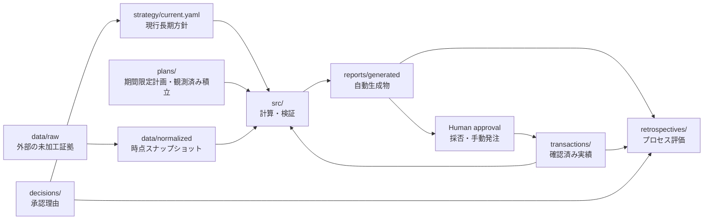

# Repository architecture

## Data flow

## Sources of truth

| Responsibility | Source of truth | Notes |
| --- | --- | --- |
| 家計・ローンの事実前提 | `FINANCIAL_ASSUMPTIONS.md` | 基準日を持つ |
| 外部の未加工証拠 | `data/raw/` | 存在しない過去証拠は再生成しない |
| 正規化済み残高 | `data/normalized/snapshot_YYYY_MM.yaml` | 時点事実、過去は原則不変 |
| 現行長期方針 | `strategy/current.yaml`が指す版 | 現在版は一意 |
| 投資仮説 | `strategy/theses/` | activeとpendingを区別 |
| 期間限定計画 | `plans/` | 承認状態と根拠スナップショットを持つ |
| 定期積立の観測状態 | `plans/recurring/current.yaml`が指す版 | 戦略との一致を意味しない |
| 注文・約定・入出金実績 | `transactions/ledger.yaml` | 確認済みだけを記録 |
| 意思決定理由 | `decisions/` | 過去記録を上書きしない |
| レトロスペクティブ | `retrospectives/` | 当時情報と結果を分離 |
| 計算・検証 | `src/`、`config/` | `config`は計算設定。戦略値の正本にしない |
| 自動生成物 | `reports/generated/` | 手編集・正本化しない |

## Legacy compatibility

`data/history/`と`prompts/generated/`は2026-07以前の生成履歴として凍結する。旧`config/portfolio_policy.yaml`、`config/allocation_rules.yaml`、`config/buy_rules.yaml`の戦略的数値は過去再現または参考計算用であり、現行戦略やactive planより優先しない。
