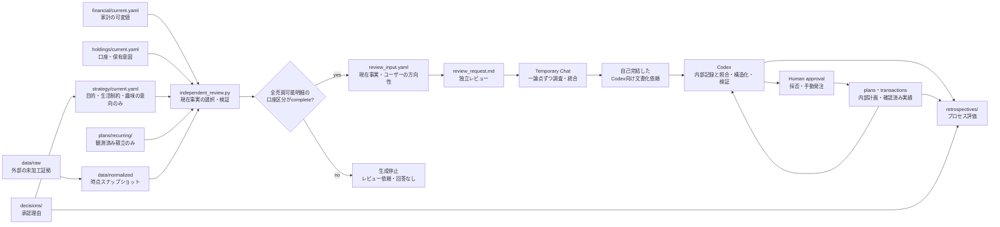

# Repository architecture

## Data flow

## Sources of truth

| Responsibility | Source of truth | Notes |
| --- | --- | --- |
| 家計・ローンの可変値 | `financial/current.yaml`が指す版 | 有効日・確認日を持つ。収入・支出等の現在値 |
| 口座・売却可否・保有意図 | `holdings/current.yaml`が指す版 | スナップショットを改変せず実行時に重ねる |
| 家計値の読み方・不変ルール | `FINANCIAL_ASSUMPTIONS.md` | 数値の正本にしない |
| 外部の未加工証拠 | `data/raw/` | 存在しない過去証拠は再生成しない |
| 正規化済み残高 | `data/normalized/snapshot_YYYY_MM.yaml` | 時点事実、過去は原則不変 |
| 現行長期方針 | `strategy/current.yaml`が指す版 | 現在版は一意 |
| 投資仮説 | `strategy/theses/` | activeとpendingを区別 |
| 期間限定計画 | `plans/` | 承認状態と根拠スナップショットを持つ |
| 定期積立の観測状態 | `plans/recurring/current.yaml`が指す版 | 戦略との一致を意味しない |
| 注文・約定・入出金実績 | `transactions/ledger.yaml` | 確認済みだけを記録 |
| 意思決定理由 | `decisions/` | 過去記録を上書きしない |
| レトロスペクティブ | `retrospectives/` | 当時情報と結果を分離 |
| 計算・検証 | `src/`、`config/` | `config`は計算設定。戦略値の正本にしない |
| 自動生成物 | `reports/generated/` | 手編集・正本化しない |

## Independent review boundary

共通ルールは`docs/independent-review.md`に置く。`generate-review-prompt`と互換名`monthly-run`は、現在のスナップショット、currentが指す家計・口座・積立の事実、ユーザーの目的・生活制約・趣味の意向を選ぶ。現行戦略は運用上の正本として維持するが、レビュー入力にはその配分・銘柄・上限や以前の推奨理由を含めない。必要なら独立ChatGPTが再提案し、ユーザー承認後にだけCodexが反映する。

入力生成は`independent_review.py`、テンプレートは`independent_review_template.md`、入力契約は`independent-review-input.schema.yaml`を使用する。市場データ取得、候補注文生成、既存計画からの保有数量投影を経由しない。全売買可能明細の口座ゲートは生成前に維持する。数量・評価額・資料差・nullはスナップショットどおり残す。

毎回新しいTemporary Chatへ本文全体を渡す。初回の一論点と後続の調査順・分析手法はChatGPTが選び、各工程はユーザーの明示指示で進む。確認済み情報の統合と、自己完結したCodex向け文書化依頼を別工程にする。過去回答・仮説・計画・タスク進捗・Codexの警告や評価は独立入力へ渡さない。結果の同一性や、意図的な差異を求めない。

回答後の現行戦略・計画・税務・注文仕様との照合、スキーマへの変換、関連検証はCodexが担当する。独立レビュワーへ大きな回答YAMLスキーマを強制しない。従来のReviewPacket・review_response.yamlは履歴互換の経路として残し、新規包括レビューの前提にはしない。

補助的なヘルスチェックは継続するが、その結果を次の独立レビューへ自動注入しない。取引や未反映注文に判断を実際に変える事実があれば、Codexが内部確認し、その現在の影響だけをスナップショット等へ整理する。

## Legacy compatibility

`data/history/`と`prompts/generated/`は2026-07以前の生成履歴として凍結する。旧`config/portfolio_policy.yaml`、`config/allocation_rules.yaml`、`config/buy_rules.yaml`の戦略的数値は過去再現または参考計算用であり、現行戦略やactive planより優先しない。
